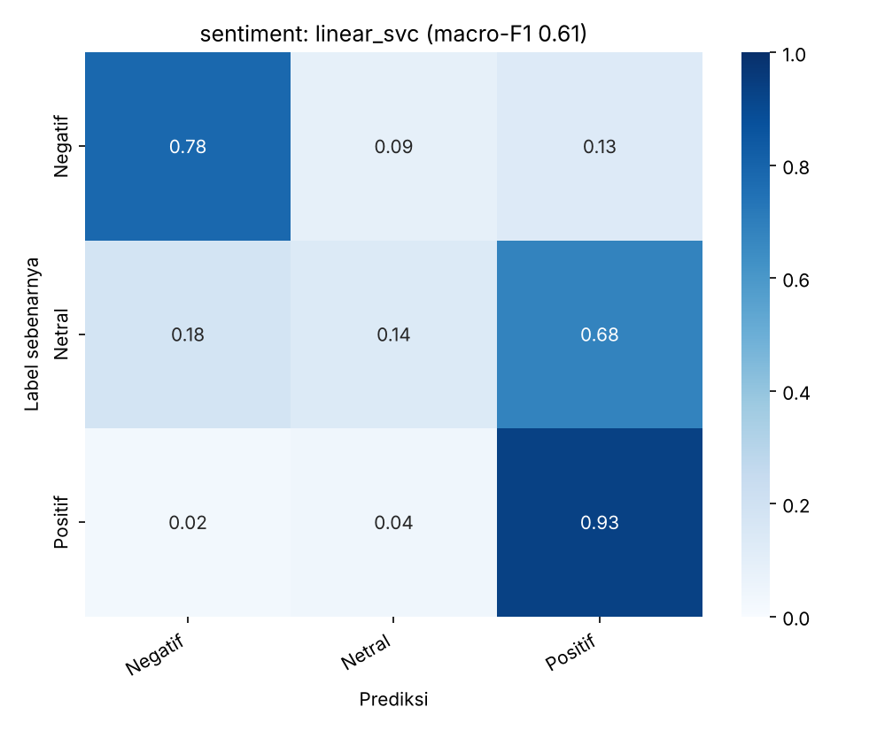

# Media Monitoring ML — Klasifikasi Sentimen, Tone, Topik, dan Tier Media

Pipeline NLP untuk mengotomatiskan sebagian pekerjaan *media analyst*: membaca judul berita lalu
memberi label **sentimen**, **tone**, **topik**, dan memperkirakan **tier media**.
Data berasal dari pekerjaan monitoring media sebuah institusi pendidikan tinggi (Jan–Okt 2026, ±830 berita
setelah cleaning).

> **Ketersediaan data.** Data asli berisi nama tokoh dan hasil kerja monitoring organisasi, sehingga
> **tidak dipublikasikan** di repo ini. Folder `data/sample/` berisi **data sintetis** (fiktif) dengan skema
> identik, agar seluruh kode bisa dijalankan ulang. Metrik di bawah berasal dari data asli;
> metrik pada data sintetis tidak bermakna (templatenya terlalu mudah) dan hanya untuk memastikan kode berjalan.

## Demo

🔗 **Demo online:** _(https://media-monitoring-ml-dfqo5bnr5x6psskbunf8kr.streamlit.app/)_

Tempel judul berita, lalu aplikasi menampilkan prediksi sentimen, tone, dan topik beserta tingkat keyakinannya.
Dashboard juga menampilkan baseline proyeksi jumlah berita media UIN Jakarta untuk 1–6 bulan ke depan,
yang mengikuti filter tier dan topik.
Model demo dilatih dengan `--deploy`: fitur TF-IDF **di-hash** sehingga file model **tidak menyimpan kosakata,
judul, atau nama** dari data asli (performanya sedikit di bawah model penuh: macro-F1 sentimen 0.59, tone 0.43,
topik 0.47).

```bash
python src/train.py --task sentiment --deploy   # juga: tone, topic -> deploy_models/
streamlit run app/app.py
```

## Hasil (data uji 20%, split stratified, seed 42)

| Tugas | Kelas | n uji | Model terbaik (CV) | Accuracy | Macro-F1 | Baseline macro-F1* |
|---|---|---|---|---|---|---|
| Sentimen | 3 | 167 | TF-IDF + Linear SVM | 0.81 | **0.61** | 0.28 |
| Tone | 6 | 167 | TF-IDF + Linear SVM | 0.59 | **0.46** | 0.09 |
| Topik (weak label) | 8 | 152 | TF-IDF + Linear SVM | 0.62 | **0.53** | 0.06 |
| Tier media (split per sumber) | 3 | 172 | TF-IDF + Linear SVM | 0.55 | **0.40** | 0.25 |

\*Baseline = selalu menebak kelas mayoritas. Karena kelasnya tidak seimbang (Positif ±73%), **macro-F1** dipakai
sebagai metrik utama, bukan accuracy.



### Temuan utama
- **Kelas Netral paling sulit** (recall ±0.14): judul netral sering diprediksi Positif. Judul berita bernada
  informatif/seremonial memang tipis bedanya dengan berita positif, dan kelas ini kecil (±110 contoh).
- **Label tidak sepenuhnya konsisten antar-annotator.** Proporsi label Positif per PIC berkisar 62%–89%
  (lihat `src/eda.py`, bagian 8). Ini membatasi batas atas performa model dan menjadi alasan utama
  untuk membuat pedoman pelabelan yang lebih tegas.
- **Tier media nyaris ditentukan oleh nama sumber, bukan isi judul.** Dengan split per sumber (model diuji
  pada sumber yang belum pernah dilihat), macro-F1 turun ke 0.40. Jika split acak dipakai, angkanya akan
  terlihat jauh lebih bagus karena model hanya menghafal sumber (*data leakage*). Karena itu tugas ini
  dipakai sebagai studi kasus evaluasi yang benar, bukan klaim akurasi.
- **Topik adalah *weak label***: dibuat dari aturan kata kunci pada kolom `Kata Kunci` (lihat `TOPIC_RULES`
  di `src/prepare_data.py`), lalu model memprediksinya hanya dari judul. Kelas `lainnya` besar (±30%).

### Keterbatasan
Data kecil (±830 baris) dan hanya berupa judul; satu institusi dan satu periode; label dibuat manusia
tanpa pengukuran kesepakatan antar-annotator. Hasil tidak boleh digeneralisasi ke domain lain.

## Struktur proyek
```
├── data/
│   ├── raw/            # Excel asli (di-.gitignore)
│   ├── processed/      # clean.csv (di-.gitignore)
│   └── sample/         # data sintetis (boleh dipublikasikan)
├── src/
│   ├── utils.py            # path & fungsi bersama
│   ├── prepare_data.py     # cleaning + fitur turunan
│   ├── eda.py              # grafik eksplorasi -> reports/figures
│   ├── train.py            # TF-IDF + LogReg / Linear SVM / ComplementNB, CV, evaluasi (--deploy: mode hashing)
│   ├── train_indobert.py   # (opsional) fine-tune IndoBERT, jalankan di Colab GPU
│   └── make_sample.py      # pembuat data sintetis
├── app/app.py          # demo Streamlit
├── deploy_models/      # model hashing tanpa kosakata (boleh dipublikasikan, dipakai demo online)
├── reports/            # metrik (JSON) & gambar (tanpa nama orang)
└── requirements.txt
```

## Cara menjalankan

```bash
python -m venv .venv && source .venv/bin/activate     # Windows: .venv\Scripts\activate
pip install -r requirements.txt
```

**A. Dengan data sintetis (siapa saja bisa):**
```bash
python src/make_sample.py
python src/train.py --task sentiment --data data/sample/sample_synthetic.csv --tag sample
```

**B. Dengan data asli (pemilik data):** taruh Excel di `data/raw/media_monitoring.xlsx`, lalu
```bash
python src/prepare_data.py
python src/eda.py
python src/train.py --task sentiment
python src/train.py --task tone
python src/train.py --task topic
python src/train.py --task tier
streamlit run app/app.py
```

## Metodologi singkat
1. **Cleaning**: normalisasi label (mis. `Koletif`→`Kolektif`), buang baris tanpa label dan judul duplikat,
   gabungkan kelas Tone yang sangat langka (`Provokatif` + `Alarmis`).
2. **Fitur**: TF-IDF kata (1–2-gram) + TF-IDF karakter (2–5-gram, tahan terhadap variasi ejaan).
3. **Model**: baseline mayoritas, Logistic Regression, Linear SVM, Complement Naive Bayes; semuanya dengan
   penanganan imbalance (`class_weight="balanced"`).
4. **Evaluasi**: Stratified (Group) K-Fold CV di data latih untuk memilih model; data uji dipakai **sekali**.
   Untuk tier, split dilakukan per `Sumber`.
5. **Analisis error**: daftar prediksi salah dan kata berpengaruh disimpan di `outputs_private/` (tidak dipush
   karena memuat judul asli).

## Rencana pengembangan
- Fine-tune IndoBERT (`src/train_indobert.py`) dan bandingkan dengan baseline TF-IDF.
- Ambil isi berita (bukan hanya judul) dan ukur kenaikan performanya.
- Ukur kesepakatan antar-annotator (Cohen's kappa) pada sampel yang dilabeli ulang oleh dua orang.
- Topik multi-label dan NER untuk menarik nama tokoh otomatis.

### Proyeksi volume berita
Dashboard menggunakan rata-rata jumlah berita dari tiga bulan kalender lengkap terakhir dan mengulang
baseline tersebut untuk horizon 1–6 bulan. Bulan data terakhir yang belum lengkap tidak digunakan sebagai
dasar perhitungan. Karena data saat ini baru mencakup sekitar 10 bulan, proyeksi ini tidak menangkap pola
musiman dan sebaiknya dipakai sebagai indikasi awal, bukan target atau angka kepastian.
